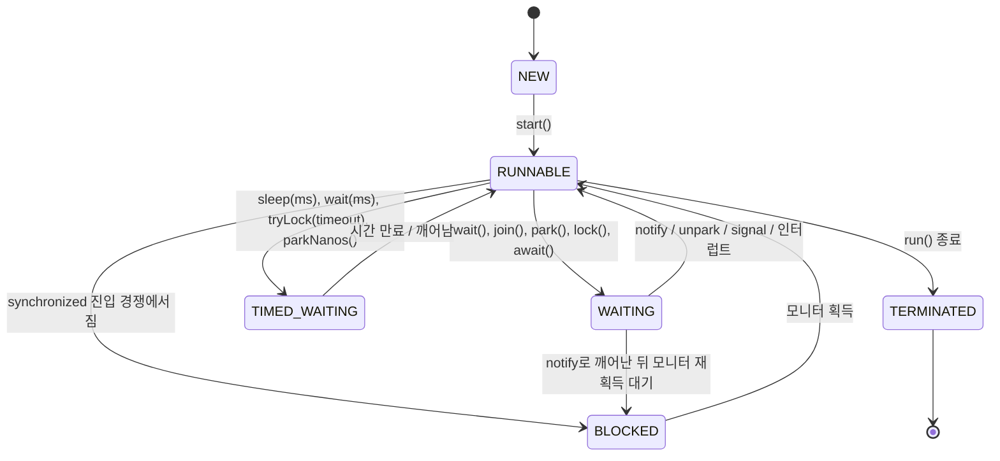

# 1. 자바 스레드 모델

락은 "여러 스레드가 동시에 실행될 때" 필요한 도구입니다. 그래서 먼저 자바 스레드가 무엇이고, OS 위에서 어떻게 돌고, 어떤 상태를 오가는지 알아야 합니다.

## 1.1 스레드란

| 스레드마다 따로 가짐 | 모든 스레드가 공유함 |
|---|---|
| 프로그램 카운터(PC), 레지스터 | 힙(heap): `new`로 만든 모든 객체 |
| 스택: 지역 변수, 메서드 호출 프레임 | 메서드 영역: 클래스 정보, `static` 필드 |

- **지역 변수는 다른 스레드가 볼 수 없습니다.** 그래서 지역 변수만 쓰는 코드에는 락이 필요 없습니다.
- 문제는 **힙에 있는 객체의 필드**입니다. 여러 스레드가 같은 필드를 읽고 쓰면 경쟁(race)이 생깁니다.
- 이 프로젝트의 모든 예제는 결국 "공유 필드를 어떻게 안전하게 다룰까"에 대한 답입니다.

## 1.2 플랫폼 스레드: OS 스레드와 1:1

`new Thread()`나 `Thread.ofPlatform()`으로 만든 스레드는 **OS 커널 스레드 하나에 대응**합니다.

```
자바 Thread 객체 ──1:1── HotSpot JavaThread (C++) ──1:1── OS 커널 스레드
```

- **생성:** HotSpot이 Linux에서는 `pthread_create`, Windows에서는 `_beginthreadex`를 부릅니다. 스레드마다 스택 메모리(64비트에서 보통 1MB, `-Xss`로 조정)를 따로 잡습니다.
- **스케줄링:** 어느 스레드를 언제 어느 코어에서 돌릴지는 **OS 스케줄러**가 정합니다. JVM은 관여하지 않습니다. `Thread.setPriority()`는 힌트일 뿐이라 대부분의 OS에서 거의 무시됩니다.
- **선점(preemption):** OS는 언제든 스레드를 멈추고 다른 스레드로 바꿀 수 있습니다. `count++`의 읽기와 쓰기 사이에서도 멈출 수 있습니다. 갱신 유실(`UnsafeCounter`)이 일어나는 근본 이유입니다.
- **비용:** 스레드를 만들고 없애는 데 시스템 콜과 메모리가 들고, 수천 개를 넘기면 메모리와 스케줄링 부담이 커집니다. 그래서 보통 스레드 풀(`ExecutorService`)로 재사용합니다.

## 1.3 컨텍스트 스위치

OS가 코어에서 돌던 스레드 A를 내리고 스레드 B를 올리는 일입니다.

1. A의 레지스터와 PC를 A의 커널 자료구조에 저장합니다.
2. B의 레지스터와 PC를 복원하고, 커널 스택을 B의 것으로 바꿉니다.
3. B가 다른 프로세스면 주소 공간(페이지 테이블)도 바꿉니다. 같은 JVM 안의 스레드끼리는 이 단계가 없습니다.

직접 비용은 수 μs 수준이지만, **B가 쓰는 데이터가 캐시에 없어서 생기는 간접 비용**이 더 클 때가 많습니다.
락 때문에 스레드가 잠들고 깨면 컨텍스트 스위치가 두 번 일어납니다. 그래서 모니터는 잠들기 전에 잠깐 스핀하며 버텨 보고, AQS는 큐에 들어가며 획득을 몇 번 다시 시도해 봅니다([3장](03-hardware-and-os.md#36-스핀-vs-블로킹) 참고).

## 1.4 스레드 상태

`Thread.getState()`가 돌려주는 6가지 상태입니다. **JVM이 보는 상태**라서 OS의 스레드 상태와 정확히 같지는 않습니다.



| 상태 | 언제 | 이 프로젝트에서 확인하는 곳 |
|---|---|---|
| `NEW` | 만들었지만 `start()` 전 | |
| `RUNNABLE` | 실행 중이거나, 코어를 기다리는 중. **I/O로 막힌 스레드도 여기에 포함**됨 | |
| `BLOCKED` | `synchronized` 진입을 기다림 (모니터 락 전용 상태) | `SynchronizedWrapperTest` |
| `WAITING` | 시간 제한 없이 기다림: `wait()`, `join()`, `LockSupport.park()`, 그리고 이것을 쓰는 `Lock.lock()`, `Condition.await()`, `Semaphore.acquire()` 등 | `ReentrantLockWrapperTest`, `WaitNotifyWrapperTest` 등 |
| `TIMED_WAITING` | 시간 제한이 있는 대기: `sleep()`, `wait(ms)`, `tryLock(timeout)`, `parkNanos()` | `ReentrantLockWrapperTest` |
| `TERMINATED` | `run()`이 끝남 | |

- **`BLOCKED`와 `WAITING`을 구분하는 기준은 무엇을 기다리느냐입니다.** `BLOCKED`는 모니터에 들어가려고(`wait()` 뒤에 다시 들어가는 경우 포함) 기다릴 때만 붙는 상태입니다. `wait()`, `join()`, `park()`처럼 API를 불러 기다리면 `WAITING`입니다. 그래서 `ReentrantLock`을 기다리는 스레드는 `park()`로 잠들기 때문에 `WAITING`이고, 같은 모니터라도 `wait()`로 기다리는 스레드는 `WAITING`입니다.
- **`RUNNABLE`에 주의하세요.** 소켓 읽기처럼 네이티브 I/O로 막힌 스레드도 JVM은 `RUNNABLE`로 보여 줍니다. 스레드 덤프에서 `RUNNABLE`이라고 실제로 CPU를 쓰고 있는 것은 아닙니다.

## 1.5 인터럽트

인터럽트는 강제 종료가 아니라 **"그만해 달라"는 협조 요청**입니다. 스레드마다 boolean 플래그가 하나 있습니다.

- `t.interrupt()`: t의 플래그를 켭니다. t가 `sleep()`, `wait()`, `join()`, `lockInterruptibly()`, `await()` 같은 **인터럽트 가능한 대기** 중이면 깨워서 `InterruptedException`을 던지게 합니다. 이때 플래그는 다시 꺼집니다.
- **인터럽트해도 포기하지 않는 대기**도 있습니다. `synchronized` 진입 대기와 `Lock.lock()`이 그렇습니다. `lock()`은 인터럽트로 잠깐 깨어나도 다시 잠들어 락을 얻을 때까지 기다리고, 얻은 뒤 인터럽트 플래그만 되살려 둡니다. 기다리다가 포기할 수 있게 `lockInterruptibly()`가 따로 있습니다(`ReentrantLockWrapper`).
- `LockSupport.park()`는 인터럽트를 받으면 돌아오지만 예외는 던지지 않습니다. 호출한 쪽이 플래그를 직접 확인해야 합니다.
- `InterruptedException`을 잡았는데 바로 처리할 수 없다면 `Thread.currentThread().interrupt()`로 플래그를 다시 켜 둡니다. 그래야 호출한 쪽이 인터럽트 사실을 알 수 있습니다. `CountDownLatchWrapper`, `CyclicBarrierWrapper`에서 이렇게 합니다.

## 1.6 데몬 스레드

- JVM은 **비데몬 스레드가 하나도 남지 않으면** 종료합니다. 남아 있던 데몬 스레드는 그 자리에서 사라지고, `finally` 블록도 실행되지 않습니다.
- 데몬 여부는 만든 스레드에게서 물려받습니다. `main`이 비데몬이므로 기본값은 비데몬입니다. `start()` 전에만 바꿀 수 있습니다.
- **JVM만의 개념입니다.** OS가 보기에는 똑같은 스레드입니다.
- 이 프로젝트의 테스트 스레드는 모두 데몬입니다. 교착된 스레드가 남아도 테스트 JVM이 끝날 수 있게 하려는 것입니다.

## 1.7 가상 스레드 (Java 21) <a id="virtual-thread"></a>

`Thread.ofVirtual()`이나 `Executors.newVirtualThreadPerTaskExecutor()`로 만듭니다. OS 스레드가 아니라 **JVM이 관리하는 가벼운 스레드**입니다(M:N 모델).

```
가상 스레드 수천~수백만 개
       │ mount / unmount
       ▼
캐리어 스레드 (= 플랫폼 스레드, 기본적으로 코어 수만큼, ForkJoinPool)
       │ 1:1
       ▼
OS 커널 스레드
```

- **블로킹하면 내려옵니다(unmount).** 가상 스레드가 `park()`, 소켓 I/O, `sleep()`으로 막히면 JVM은 그 스택을 힙의 컨티뉴에이션 객체에 저장하고 캐리어에서 내립니다. 캐리어는 곧바로 다른 가상 스레드를 실행합니다. OS 스레드는 잠들지 않습니다.
- **pinning (Java 21의 한계):** 가상 스레드가 `synchronized` 블록 안에서 블로킹되면 내려오지 못하고 캐리어를 붙잡습니다. 모니터 소유권이 OS 스레드 기준으로 기록되기 때문입니다. 캐리어 수가 코어 수뿐이라, 이런 스레드가 몇 개만 있어도 전체가 멈출 수 있습니다.
  - `-Djdk.tracePinnedThreads=full`로 발생 지점을 볼 수 있습니다.
  - JDK 24(JEP 491)에서 `synchronized`의 pinning은 해결되었습니다. 네이티브 메서드 안에서의 블로킹은 여전히 pinning됩니다.
  - Java 21에서는 `ReentrantLock`을 쓰면 이 문제를 피할 수 있습니다. AQS는 `park()`로 대기하고, 가상 스레드의 `park()`는 unmount되기 때문입니다.
- 이 프로젝트의 예제와 테스트는 **플랫폼 스레드 기준**입니다. 관찰 결과가 주석의 OS 설명과 맞도록 하기 위해서입니다.

## 1.8 스레드를 직접 만들기 vs `ExecutorService`

| | `Thread` 직접 | `ExecutorService` |
|---|---|---|
| 스레드 | 작업마다 생성·소멸 | 풀에서 재사용 |
| 작업 예외 | 스레드가 죽고 stderr에 출력만 됨. 호출자는 모름 | `Future`에 담김. `get()`이 `ExecutionException`으로 다시 던짐 |
| 결과·완료 대기 | `join()` | `Future.get()`, `invokeAll()`, `shutdown()` + `awaitTermination()` |
| 종료 | 스레드가 끝나면 끝 | `shutdown()`/`shutdownNow()`/`close()`를 반드시 불러야 함. 기본 스레드가 비데몬이라 안 부르면 JVM이 끝나지 않을 수 있음 |

테스트 도우미 `TestThreads.runConcurrently`는 `ExecutorService`로 스레드를 관리합니다. `execute()`는 작업을 넘기기만 하고 바로 돌아오므로, 작업이 출발선에 모였는지는 `ready` 래치로 확인한 뒤 출발 신호를 보냅니다. 완료는 `Future`가 아니라 `CountDownLatch`로 기다리고, 작업 예외는 작업 안에서 직접 잡아 큐에 모읍니다. 그래서 첫 예외만이 아니라 실패한 작업의 예외를 모두 보고할 수 있습니다.
